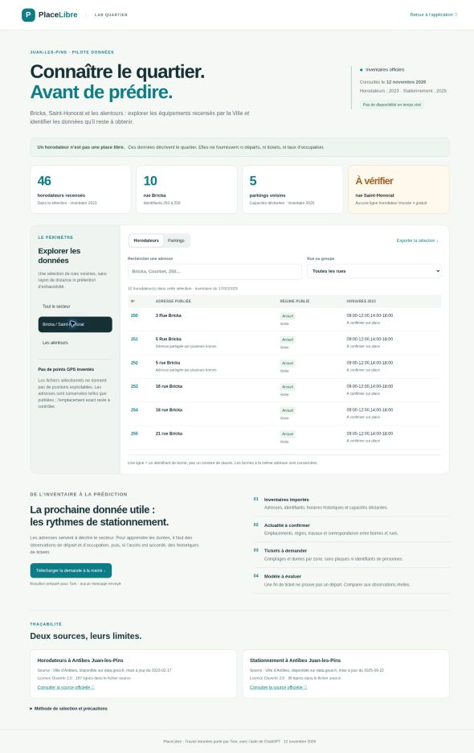

# PlaceLibre

Prototype collaboratif de recherche de stationnement, avec un pilote autour des rues Bricka et Saint-Honorat à Juan-les-Pins.

## Données du pilote

Le dossier [Bricka / Saint-Honorat et alentours](docs/donnees-pilote.md) décrit les inventaires municipaux importés, leurs limites et les prochaines demandes de données. Ouvrir `/donnees-pilote/` après lancement local, ou suivre le lien dans les réglages de l’application.



## Point de départ

La base a été importée depuis le HTML publié sur Netlify le 11 novembre 2026. Les PR suivantes ont séparé le JavaScript, ajouté un mode liste, un journal et des contrôles de disponibilité, puis modifié le design et l’accueil. L’historique antérieur à l’import et les éventuels fichiers non publiés ne sont pas inclus.

Le modèle local est expérimental : la présence du code ne démontre pas la fiabilité des prédictions.

## Lancer sur son ordinateur

Prérequis : Python 3 et un navigateur récent. WebGL est nécessaire pour la carte 3D ; un mode liste est disponible.

```bash
git clone https://github.com/placelibre-team/placelibre.git
cd placelibre
python3 -m http.server 8000 --bind 127.0.0.1 --directory public
```

Sous Windows, utiliser `py -m http.server 8000 --bind 127.0.0.1 --directory public` si nécessaire.
Ouvrir http://localhost:8000 dans le navigateur.

La carte, la recherche et le service de signalements utilisent des services externes : une connexion Internet est nécessaire. La géolocalisation demande l'autorisation du navigateur. Sur téléphone, utiliser une adresse HTTPS ; `localhost` sur le téléphone ne désigne pas l'ordinateur.

## Lancer les tests

Depuis la racine du dépôt, avec Python 3 et Node.js :

```bash
python3 -m unittest tests/test_pilot_data.py
node tests/pilot-rules.test.cjs
```

## Attention pendant les essais

Le code importé conserve le canal de signalements du prototype en ligne. Les boutons de signalement peuvent donc écrire dans ce canal : ne pas envoyer de fausses données. Isoler un canal de test avant les essais automatisés ou les simulations.

Les pourcentages sont expérimentaux. La cartographie et les règles doivent être vérifiées sur le terrain. Sans WebGL, vérifier le fonctionnement du mode liste.

## Organisation

- `public/index.html`, `public/js/` : interface et modules de l’application.
- `public/donnees-pilote/` : explorateur des inventaires municipaux.
- `scripts/import_pilot_data.py`, `data/sources/` : import reproductible et sources publiques datées.
- `docs/demande-mairie.md` : brouillon de demande à la mairie, conservé hors du site déployé. Le dépôt GitHub étant public, ce fichier reste consultable sur GitHub.
- `CONTRIBUTING.md` : méthode de collaboration.
- `docs/ROADMAP.md` : prochaines tâches techniques.
- `netlify.toml` : préparation d'un déploiement statique depuis `main`.
- `.github/pull_request_template.md` : modèle de demande de relecture.


## Publication

Les changements passent par une branche et une pull request, puis une relecture avant fusion. Consulter les contrôles Netlify de la pull request pour connaître le résultat du déploiement de son aperçu. La présence du code sur une branche ne signifie pas qu’il est intégré à `main`.

Les données personnelles, historiques GPS et clés ne doivent pas être déposés dans Git. Le dépôt contient le code, pas une base de données partagée des utilisateurs.
