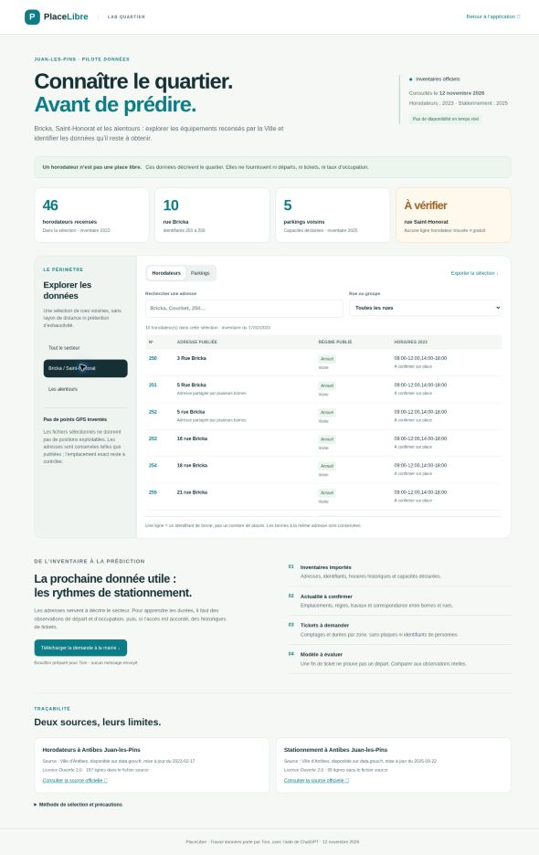

# Données du pilote — Bricka / Saint-Honorat et alentours

Travail porté par **Tom**, réalisé avec l’aide de ChatGPT le **12 novembre 2026**.

## Livré

- Import reproductible des deux inventaires municipaux, snapshots conservés et empreintes SHA-256 dans le JSON.
- **46 horodateurs** sélectionnés parmi **197 lignes** municipales : 10 Bricka, 5 Courbet, 6 Estérel, 3 Louis Gallet, 4 Maréchal Joffre, 2 Alexandre III, 8 Charles Guillaumont et 8 bornes de parkings voisins.
- **5 parkings** : Courbet (141 places dont 6 PMR), Dulys 1 (81 dont 5 PMR), Dulys 2 (71 dont 4 PMR), gare de Juan-les-Pins (17), Nation (24). Pour les deux derniers, le nombre PMR est non renseigné. Ce sont des capacités déclarées en 2025, jamais des disponibilités.
- Écran `public/donnees-pilote/index.html` : filtres cœur / alentours, recherche, groupes, distinction horodateurs / parkings, export CSV de la sélection, téléchargement JSON et liens vers les sources. Accessible depuis les réglages de l’application.
- Correction ciblée : Saint-Honorat n’est plus étiquetée gratuite par défaut ; « Tarif à confirmer ». Les segments préconfigurés passent au type inconnu. Les identifiants des places sont conservés.
- Demande de données préparée dans `public/donnees-pilote/demande-donnees.txt`. **Aucun envoi effectué.**

## Sources vérifiées et accès

| Source | Date du fichier / consultation | Ce qu’elle apporte | Limite |
|---|---|---|---|
| [Ville d’Antibes — Horodateurs](https://www.data.gouv.fr/datasets/horodateurs-a-antibes-juan-les-pins) | Fichier du 17/02/2023 ; téléchargé le 12/11/2026 | Numéro de borne, adresse textuelle, régime annuel/saisonnier, horaires historiques | Pas de GPS, de ticket, d’occupation ou de garantie d’actualité |
| [Ville d’Antibes — Stationnement](https://www.data.gouv.fr/datasets/stationnement-a-antibes) | Fichier du 22/09/2025 ; téléchargé le 12/11/2026 | Adresse, capacité totale, PMR lorsque renseigné | Coordonnées vides pour les 5 parkings retenus ; capacités ≠ places libres |
| [Ville — Stationner en ville](https://www.antibes-juanlespins.com/vivre-a-antibes/deplacement-et-stationnement/parkings-et-stationnement) | Consultée le 12/11/2026 | Contexte de fonctionnement, paiement mobile Flowbird, règles générales de voirie | Ne suffit pas à attribuer un régime à chaque portion de rue ; la page présente des formulations tarifaires à clarifier |
| [Annuaire officiel — Mairie](https://lannuaire.service-public.gouv.fr/provence-alpes-cote-d-azur/alpes-maritimes/eed9faf1-9551-4ecd-b40e-aa7b6f61f415) | Consulté le 12/11/2026 | Contact général mairie@ville-antibes.fr ; 04 92 90 50 00 | Demander l’orientation vers le service stationnement / données ouvertes |

Les deux inventaires sont sous **Licence Ouverte 2.0**. Attribution : « Source : Ville d’Antibes, disponible sur data.gouv.fr, mise à jour du [date du fichier] ». Les URL originales et la provenance de chaque ligne sont incluses dans le JSON. Ne pas confondre date de téléchargement et date d’actualisation municipale.

## Périmètre et qualité

Le cœur est constitué de Bricka et Saint-Honorat. La sélection des alentours est nominale : Courbet, Estérel, Louis Gallet, Maréchal Joffre, Alexandre III, Charles Guillaumont et les parkings voisins listés ci-dessus. **Ce n’est ni un rayon calculé ni un inventaire exhaustif.** Certains axes sont plus éloignés que d’autres ; aucune distance n’est affirmée.

- Bricka : numéros 250 à 259. Les bornes 251 et 252 partagent l’adresse « 5 rue Bricka » après normalisation. Elles sont conservées séparément : deux identifiants ne prouvent ni un doublon ni deux équipements encore présents.
- Saint-Honorat : aucune ligne trouvée dans le fichier municipal des horodateurs, après normalisation du nom. Cela ne prouve pas une gratuité, une interdiction ou l’absence d’équipement aujourd’hui.
- Aucune coordonnée n’est fabriquée ni copiée depuis les segments approximatifs du prototype. Les exports mettent `coordinates: null`, `availability: null`, `observedAt: null`, `fieldVerified: false`.
- Le fichier municipal nommé `.csv` de stationnement est en réalité du texte à largeur fixe. L’import valide les positions des colonnes ; il échoue si la structure change. Certains en-têtes sont accolés : les champs ambigus ne sont pas exploités.
- Les identifiants de parkings source sont répétés (`06004-P-`) : les identifiants normalisés sont construits depuis le nom et explicitement locaux au projet.
- Les agrégats « Juan-les-Pins centre » ne sont pas répartis artificiellement sur Bricka ou Saint-Honorat. Les capacités PMR sont incluses dans les capacités totales, pas ajoutées.
- Le recensement 2023 contient des parkings saisonniers : leurs horaires ne sont pas remplacés par les horaires généraux de voirie. Aucun calcul « payant maintenant » n’est ajouté dans l’explorateur.

## Ce que ces données peuvent apporter au modèle

**Maintenant :** décrire le secteur, identifier les équipements, préparer une cartographie vérifiable et organiser la collecte. L’inventaire n’est pas injecté comme signal de disponibilité et ne modifie pas les probabilités.

**Après accord d’accès :** étudier les débuts de tickets et les distributions de durée par zone et tranche horaire. Préférer des statistiques agrégées sans plaque, sans identifiant individuel et sans trajet. Documenter couverture, fuseau, renouvellements, tickets gratuits, abonnements, annulations et fréquence. Une fin prévue ne confirme pas un départ ; les véhicules sans ticket rendent l’occupation partiellement invisible.

**Validation nécessaire :** comparer à des observations terrain de départ / occupation, sur des jours distincts de l’apprentissage ; vérifier séparément les horizons 5, 10 et 30 minutes. Ne pas annoncer une précision ni une quantité de données suffisante avant mesure.

## Demandes à faire

1. Mairie : confirmer le régime de Saint-Honorat et les portions de Bricka, fournir l’inventaire actuel, les coordonnées et la correspondance borne → zone.
2. Demander 8 à 12 semaines d’historiques agrégés disponibles (durées, débuts et fins prévues, prolongations), leur dictionnaire, couverture et éventuelles lacunes. Cette période est une proposition de pilote, pas une condition suffisante de validation.
3. Clarifier licence, autorisation de réutilisation, coûts, fréquence et API éventuelle. L’accès local aux transactions est **non confirmé**, pas déclaré impossible.
4. La page municipale cite Flowbird pour le paiement mobile : faire confirmer par la Ville l’interlocuteur compétent et les droits d’accès avant une démarche technique. Ne pas supposer une API ouverte.
5. Faire vérifier les adresses et restrictions sur place lorsque quelqu’un est disponible.

Le brouillon est téléchargeable depuis l’explorateur. Il reste à relire et envoyer par l’équipe. Aucun contact, compte, partenariat ou accès aux tickets n’a été créé.

## Reproduire et vérifier

```sh
python3 scripts/import_pilot_data.py
python3 -m unittest discover -s tests -p 'test_*.py'
node tests/pilot-rules.test.cjs
python3 -m http.server 8000 --bind 127.0.0.1 --directory public
```

Ouvrir `/donnees-pilote/`. L’explorateur n’utilise pas le canal de signalements, ne demande pas de position et n’écrit pas dans le journal des utilisateurs. Pour renouveler un snapshot : vérifier sa licence et sa structure, conserver sa date source, mettre à jour la provenance, examiner le diff et adapter les assertions de contrôle. Ne pas remplacer un fichier source sans revue.

## Limites de livraison

Accès à l’organisation autorisé le 12/11/2026. Travail préparé sur la branche `donnees-pilote-bricka-saint-honorat`, mis à jour après fusion de la PR #5 (prévision à l’arrivée), pour relecture avant fusion dans `main`.

L’intégration est proposée par branche et pull request, pour relecture de l’équipe avant fusion. Elle ne remplace ni un test terrain, ni un service d’occupation en direct, ni une base partagée de tickets. Le modèle historique existant reste expérimental ; le traitement de l’inconnu côté tarification n’est pas une validation de ce modèle.

## Rendu et contrôles du 12 novembre 2026



Capture réelle de l’aperçu local dans Chrome. Contrôles effectués : lien depuis les réglages, 10 bornes dans le cœur du pilote, sélection Saint-Honorat vide avec explication, 5 parkings, recherche Dulys (2 résultats) et téléchargement CSV contenant les capacités 81 et 71. Quatre tests Python et la régression JavaScript sur le tarif inconnu passent. Le contrôle syntaxique des fichiers JavaScript modifiés et `git diff --check` passent.

La carte 3D n’a pas pu être contrôlée dans ce navigateur distant (WebGL indisponible) ; le mode liste et l’explorateur ont été vérifiés. Aucun signalement de test n’a été envoyé et aucune validation terrain n’a été réalisée.
